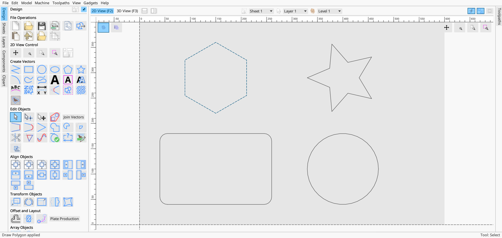
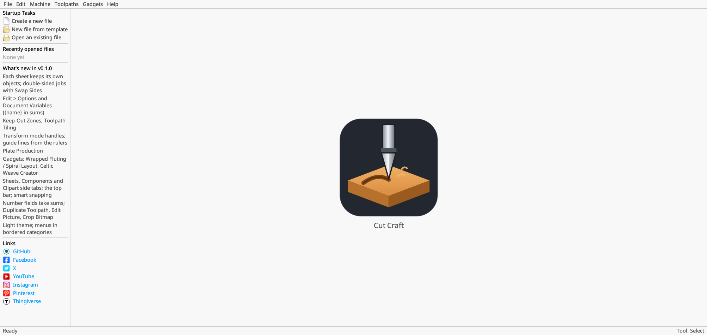
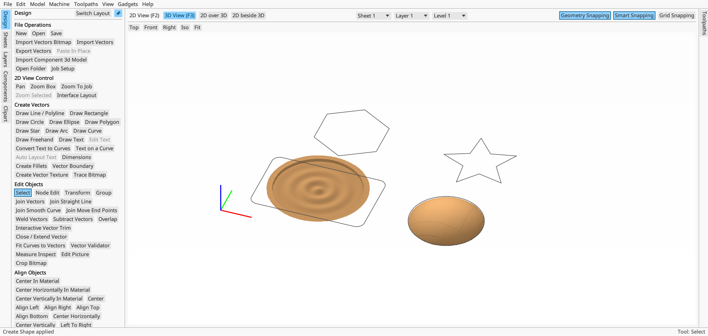
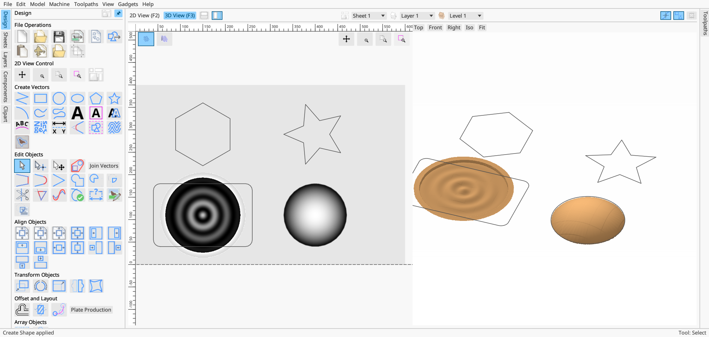
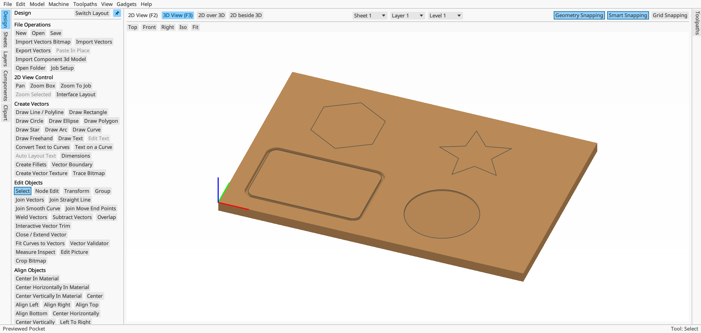
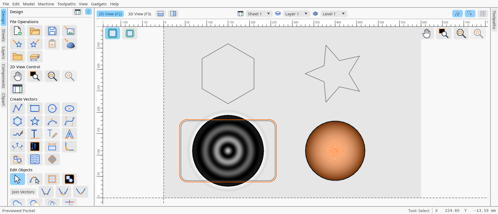
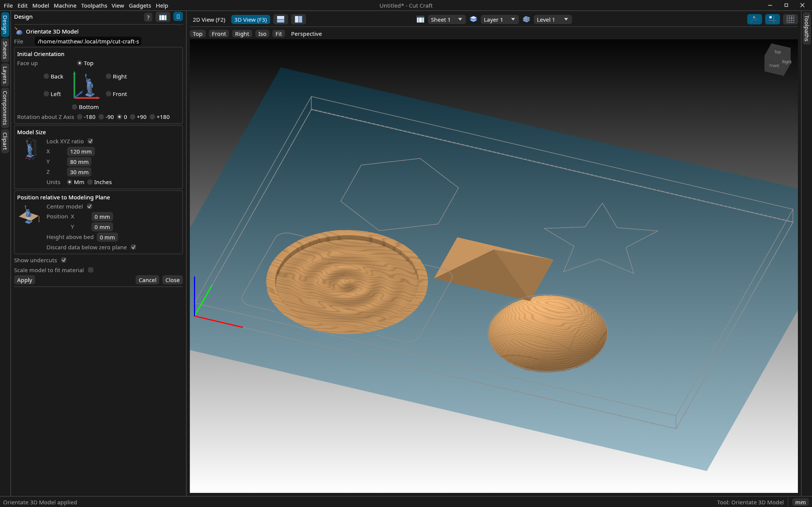
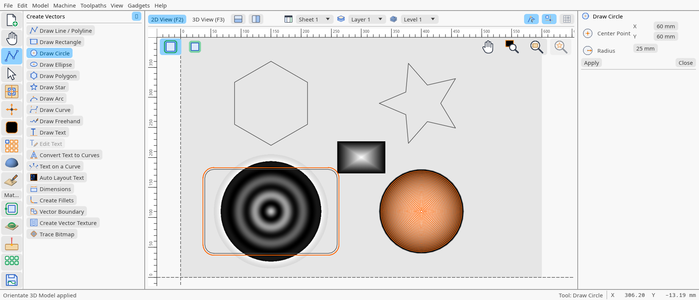
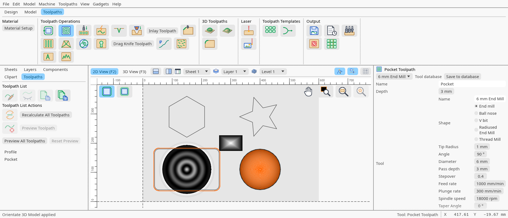

# Cut Craft

A desktop app for designing 2D and 3D work and turning it into CNC toolpaths and G-code.
Draw vectors, build relief models, pick tools from a tool database, preview the cut in 3D and
save G-code for your machine, all in one window. Written in Rust; runs on Linux, macOS and Windows.

Cut Craft is a personal, educational project, and an early **alpha**: expect rough edges, and
please report them (see [Reporting bugs](#reporting-bugs)).



## Contents

- [What it does](#what-it-does)
- [A tour](#a-tour)
- [Getting Cut Craft](#getting-cut-craft)
- [Using it](#using-it)
- [Reporting bugs](#reporting-bugs)
- [Building from source](#building-from-source)
- [How the code is laid out](#how-the-code-is-laid-out)
- [License](#license)

## What it does

### Design (2D)

- Rectangles (square, rounded or notched corners), circles, ellipses, polygons, stars, arcs,
  curves, polylines and freehand lines; text, text on a curve, auto layout text (words
  wrapped and sized to fill a shape), dimensions.
- Node editing, joining and closing vectors, fillets, offsets, weld / subtract / overlap,
  trimming, mirroring, array and circular copies, nesting.
- Drag selected objects to move them; the arrow keys nudge by a grid square (Shift: half,
  Ctrl + Shift: a tenth). Transform mode with handles for scaling and rotating.
- Geometry, smart and grid snapping; guide lines dragged out of the rulers.
- Layers, sheets (each with its own objects), double-sided jobs, keep-out zones.
- Document variables: number fields take sums such as `{width} / 2 + 5`.

### Models (3D)

- Components built from shapes (round, angled, smooth, flat), extrusions, sweeps and turned
  profiles, arranged in levels with combine modes, clipping and mirroring.
- Import STL models: the model appears in the scene at once, and the import settings
  (which face is up, rotation, size, position, depth) move and resize it as you change them.
- Reliefs from pictures. 16-bit PNG and TIFF, and 32-bit floating point TIFF depth maps, are
  read at full precision, so smooth reliefs don't come out stepped.
- Sculpting, smoothing, slicing, offset models, draft, baking components together.
- **Model ▸ Model Resolution** (Standard / High / Highest) sets the level of detail models
  are made at.

### Toolpaths

- Profile, pocket, drilling, V-carve / engrave, 3D roughing and finishing, chamfer, fluting,
  prism carving, inlays, keyholes, moulding, rounding, thread milling, texture, sketch
  carving, photo V-carve, quick engrave, drag knife.
- **Rest machining** on any toolpath: only what earlier, larger tools left is cut.
- An animated preview of the material being cut, toolpath by toolpath.
- Toolpath tiling, templates, merging and array copies.

### Tools and machines

- A **Tool Database** of tools in groups, each with its geometry, cutting parameters, feeds
  and speeds, and chip load. It imports `.vtdb` tool databases and Fusion 360 `.tools`
  libraries, keeping their groups.
- **Machine Configuration**: your machines, with bed size, controller and post-processors.
- **Automatic tool changers**: give a machine its slots, load tools into them in the Tool
  Database, and the G-code calls each tool by its slot. Saving refuses tools that aren't loaded.
- **Post-Processor Management**: Cut Craft's own grbl / FluidNC posts (flat, and rotary on
  A), plus any `.pp` post-processor you install or customise.

### Files

- Jobs (`.ccjob`) and templates; Recent Files on the start page. Models, pictures and
  toolpaths are stored packed, so a job with a dense 3D toolpath is a fraction of the size it
  was; jobs saved by earlier builds still open.
- Every file is written whole: a save that fails (a full disk, a crash) leaves the old file as
  it was. Unsaved work is copied to `recovery.ccjob` in the settings folder every 30 seconds
  and opened again after a crash; saving or closing the job on purpose removes the copy.
- Import DXF, SVG, pictures (PNG, JPG, GIF, BMP, TIFF) and STL. Export DXF, SVG, PDF, STL and
  grayscale bitmaps, plus a job sheet.
- Drag files onto the window to open, import or install them (see [the table](#drag-and-drop)).

## A tour

The start page: start a new job, open one, or pick a recent file.



Shapes on a new job in the 2D view. The tool groups are down the left; the view, sheet,
layer, level and snapping controls are along the top.


The same job in 3D: a ringed medallion made from a height formula, and a dome made with
Create Shape on the circle.



2D and 3D side by side (**2D beside 3D**; **2D over 3D** stacks them).



A profile round the rectangle and a pocket in the circle, previewed cut into the material.



The Tool Database: groups on the left, the picked tool's details on the right. Changes are
kept only on **Apply** or **OK**.



Machine Configuration: a machine with a five-slot tool changer and three tools loaded.


Importing a 3D model: it shows in the scene at once over the modeling plane, faces a cutter
cannot reach in red (Show undercuts turns that off), and the settings on the left move and
size it as they change. **Scale model to fit material** grows it, proportions kept, until
the material's length, width or thickness stops it. A model is kept whole by default: in a
double-sided job its underside goes to the other side, in a rotary job it wraps round the
axis; **Options ▸ Importing Models** can offer the flat, top-only import instead, or both.



The window can be laid out three ways (**Options ▸ General ▸ Window layout**, or **View ▸
Window Layout**). Classic is Aspire's, above. Rail puts one icon per tool group down the
left; clicking one lists that group's tools by name, and the inspector on the right holds
the open tool's form or the sheets, layers, components, clipart and toolpath list.



Ribbon puts Design, Model and Toolpaths tabs of tool groups across the top, the browser on
the left and the open form on the right. **Ctrl+K** finds a tool by name in any layout.



These pictures are made by the app itself and can be made again at any time (see
[Screenshots](#screenshots)).

## Getting Cut Craft

| Platform | How |
|---|---|
| macOS (Apple Silicon and Intel) | Download `CutCraft-…-macos.dmg` from the repository's Releases and drag Cut Craft to Applications. It isn't signed, so the first time, right-click it and choose **Open**. |
| Linux (x86-64), AppImage | Download `CutCraft-…-x86_64.AppImage`, make it executable (`chmod +x`) and run it. One file, nothing to install; it needs FUSE 2 (`libfuse2`), which most desktops have. |
| Linux (x86-64), Flatpak | Download `cut-craft-…-x86_64.flatpak` and install it with `flatpak install --user cut-craft-…-x86_64.flatpak` (Flathub's freedesktop runtime comes with it). Inside its sandbox Report a Bug can't reach `gh`, so reports are kept on disk. |
| Linux (x86-64), archive | Download `cut-craft-…-linux-x86_64.tar.gz`, unpack it and run `./cut-craft`. Or [build from source](#building-from-source); `scripts/install-launcher` adds it to the desktop's application menu. |
| Windows (x86-64) | Download `cut-craft-…-windows-x86_64.zip`, unpack it and run `cut-craft.exe`. It isn't signed, so SmartScreen may ask first: **More info ▸ Run anyway**. Not tested much yet. |

Each release has all of them, and so does each run of **Builds** under Actions.

## Using it

### Starting a job

**Create a new file** opens Job Setup: the material's size and thickness, where Z zero and
the XY datum are, flat or rotary, and the model resolution. **OK** makes the job. Job Setup
can be opened again later from the File Operations group.

### The window

- **Left:** the side tabs (Design, Sheets, Layers, Components, Clipart). A tool's settings
  take the place of the tool groups while it is open; **Close** brings them back.
- **Right:** the Toolpaths tab, with the toolpath list and its buttons underneath.
- **Top:** 2D view (F2), 3D view (F3), the split views, the sheet / layer / level drop-downs
  and the snapping toggles.
- **3D view:** drag to orbit, middle-drag (or Ctrl + right-drag) to pan, the wheel to zoom,
  double-click a model to select it; **F** fits the view.
- **Tab** and **Shift + Tab** move between controls without the mouse; the one with focus is
  ringed.
- **Dialogs** (the Tool Database, Machine Configuration, Post-Processor Management, Options,
  Report a Bug, the Help windows) open in windows of their own, so they can sit beside the
  main window or on another screen.
- **Ctrl + X / C / V** cut, copy and paste the selected vectors. Copy puts them on the system
  clipboard, so a second Cut Craft window can paste them.
- **Units:** the `mm` / `in` button at the right of the status bar, or **Edit ▸ Units**,
  switches the whole job between millimetres and inches: the material, depths, tab
  heights, every length reads in the new units and the part stays the same size. Each
  tool in the Tool Database has units of its own and reads in those whatever the job's.

### Drag and drop

| Dropped on the window | What happens |
|---|---|
| `.ccjob` or a template | Opens (asking first about unsaved work) |
| `.stl` | Opens the 3D model import, with the model already in the scene |
| Pictures (PNG, JPG, GIF, BMP, TIFF; 16-bit and float depth maps too) | Imported as a picture |
| DXF, SVG and other files Import reads | Imported |
| `.pp` | Installed as a post-processor |
| `.vtdb`, `.tools` | Tools added to the Tool Database |

On Linux, Cut Craft opens through XWayland on a Wayland desktop, since that is where dropped
files reach it. **Edit ▸ Options ▸ Use Wayland directly** turns this off (without drag and drop).

### Machines, tools and G-code

1. **Machine ▸ Machine Configuration:** add your machine. Tick **This machine has a tool
   changer** and set its slots if it has one.
2. **Toolpaths ▸ Tool Database:** add or import your tools; load them into the tool changer's
   slots.
3. **Machine ▸ Install Post-Processor** (or drop a `.pp` on the window) if Cut Craft's own
   FluidNC post doesn't suit your controller; make it the machine's default.
4. Make toolpaths, preview them, then **Save Toolpaths**. The G-code goes through the active
   machine's default post.

### Settings

**Edit ▸ Options** holds what the views draw on start, toolpath previews, the number of recent
files, whether icons are read in advance, the repository bug reports go to, and the Wayland
choice. Settings are kept in `~/.config/cut-craft` (Linux) or
`~/Library/Application Support/cut-craft` (macOS).

## Reporting bugs

Right-click anywhere and choose **Report a Bug Here…**. Give the report a title and say what
went wrong. Cut Craft adds, without you doing anything:

- the parts of the window under the pointer, each with the source file and line that draws it;
- what the app was doing (the screen, view, open tool, job size and contents) and the build;
- a screenshot of the window, and any pictures you add.

**Submit to GitHub** files it as an issue through the [GitHub CLI](https://cli.github.com)
(`gh`, signed in). Without `gh`, your browser opens GitHub's new-issue page with the report
filled in, to finish by hand; either way a report that can't be sent is kept in the settings
folder, pictures included.

## Building from source

You need Rust (stable, edition 2024) and, on Linux, the usual graphics and windowing libraries
(Vulkan or OpenGL, X11 / Wayland).

```bash
cargo build --release
```

```bash
cargo run --release
```

### Checks

Every commit runs `.githooks/pre-commit`: `cargo fmt --check`, `cargo clippy` with warnings as
errors (pedantic), and the tests through `cargo nextest`. Turn it on after cloning:

```bash
git config core.hooksPath .githooks
```

The tests that try real vendor files (`.vtdb` and Fusion `.tools` libraries, a 16-bit
`depth.png`) read them from the folder `CUT_CRAFT_VENDOR_FILES` names, and pass silently
when it is unset.

### Release builds

`.github/workflows/builds.yml` builds all three on GitHub's runners, side by side:

- **macOS:** `scripts/macos-dmg` builds for Apple Silicon and Intel, joins them into one
  `Cut Craft.app` and packs it in a DMG. It runs on any Mac too.
- **Linux:** a release build on Ubuntu 22.04, packed as a `.tar.gz`, and by
  `scripts/linux-packages` as an AppImage and a Flatpak bundle (`packaging/linux`).
- **Windows:** a release build, packed as a `.zip`.

It runs when the workflow or the packaging changes on a pushed branch, from the Actions tab,
and on a `v*` tag, which attaches them all to that release.

### Screenshots

The pictures above are taken by the app of its own window:

```bash
cargo run --release -- --screenshots docs/screenshots
```

It sets up each scene, waits for it to settle, saves it, and quits. It reads none of your
settings and saves nothing.

Help ▸ About lists the repository's contributors on GitHub, built in from
`crates/app/contributors.tsv`; `scripts/contributors` writes that file again from GitHub
(through `gh`), so run it before a release.

### Icons

The icons are drawn for Cut Craft and kept in `assets/icons` as transparent PNGs, built into
the program so nothing has to travel beside it. `scripts/build-icons` draws them all again:
`scripts/make_icons.py` holds the flat drawings, `scripts/make_3d_icons.py` the shaded solids of
the 3D tools, and `scripts/model_pictures.py` renders the Orientate 3D Model pictures from two
STL models given on the command line (the models are not kept here). It needs `python3` with
`numpy`, and `rsvg-convert`.

`CUT_CRAFT_ICON_DIR` points Cut Craft at a folder instead while icons are being worked on; an
icon that is missing leaves its button showing its name, and everything still works. The
third-party icons and models are credited under **Help ▸ Third Party Licenses**.

## How the code is laid out

```
crates/core/              the document, invertible changes (undo), the Command contract,
                          geometry, components, simulation, rest machining
crates/commands/<name>/   one crate per command (or per family: align, select, convert-span): its settings, run(), tests
crates/formats/<name>/    one crate per importer or exporter
crates/post/              post-processors: toolpaths to G-code
crates/tool-database/     the Tool Database window, tool groups, tool library imports
crates/machines/          machines, tool changers, the post-processor library
crates/bug-report/        Report a Bug Here… and GitHub issues
crates/vtdb/              .vtdb tool database reading
crates/app/               the desktop app (the cut-craft binary)
scripts/                  new-command scaffolding, the launcher, the macOS DMG, Linux packages
packaging/linux/          the AppImage launcher, the Flatpak manifest, the desktop entry
docs/                     design notes, the tool inventory, screenshots
```

Commands are plain data in, a change out: each takes its settings (which also generate its
form) and returns an invertible change to the document, so undo, redo and recalculation work
the same for every tool. `scripts/new-command` scaffolds a new one with tests that fail until
it is written. What every tool is built from, and what is still to build:
[`docs/tool-inventory.md`](docs/tool-inventory.md).

## License

This project is for educational purposes only.
